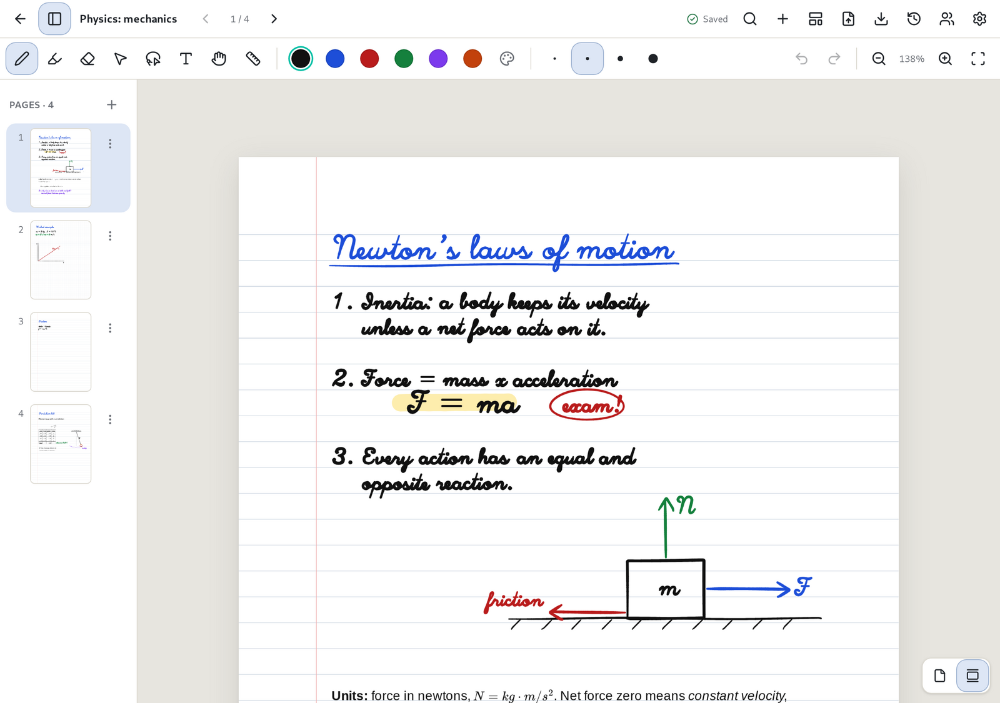
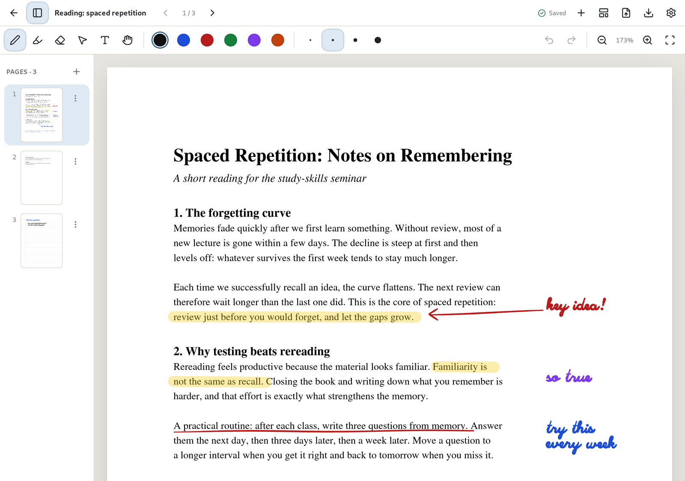
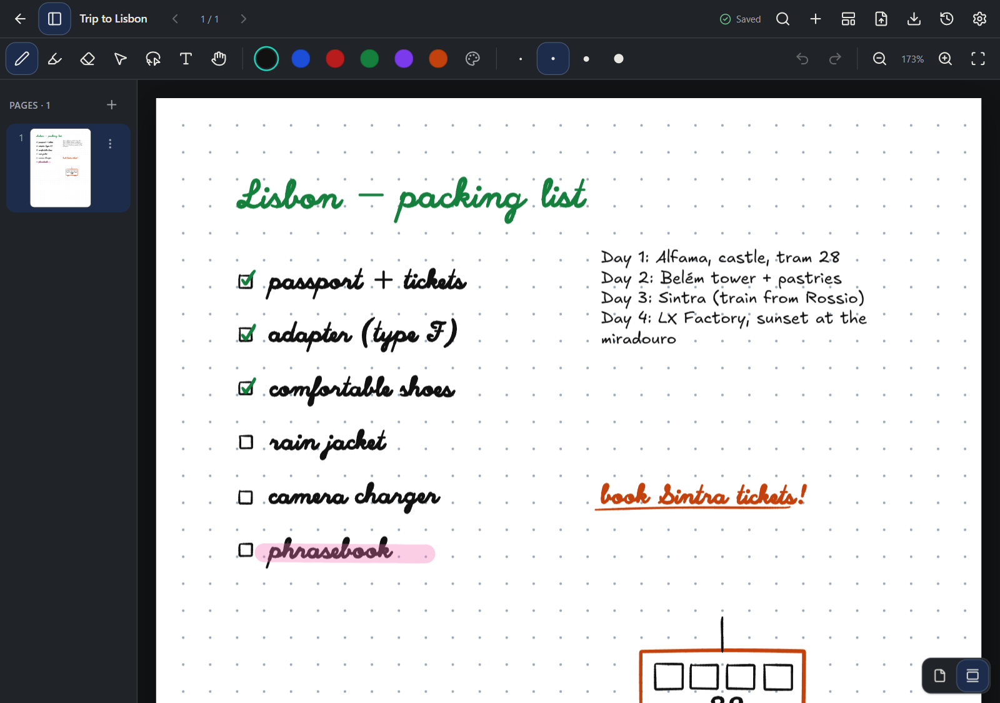
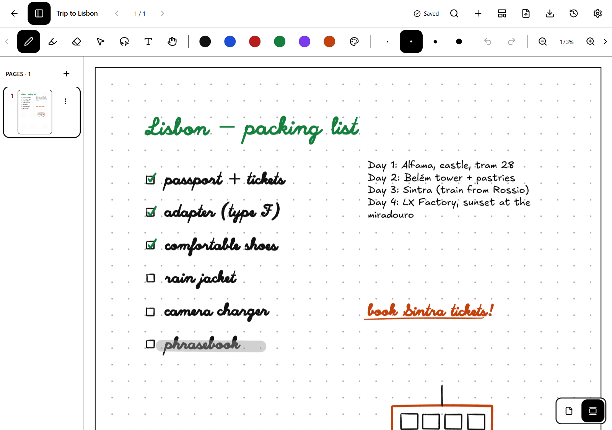

<h1> Penroam</h1>

**A handwriting-first notebook that keeps your notes on your own device.**

Penroam is a free, open-source notebook app for writing by hand with a stylus, mouse or finger.
You can type text on the same page as your ink, read and annotate PDFs, and carry notebooks
between devices as ordinary `.penroam` files. It works fully offline and doesn't need an
account, a server or a subscription.



## Highlights

- **Write naturally.** A pressure-sensitive pen, a highlighter and a stroke eraser (including
  your stylus's eraser end or side button). On BOOX e-ink tablets, ink is drawn by the device's
  own low-latency pen layer.
- **Ink and typing together.** Type on the rows of ruled or dotted paper, or place text
  anywhere on the page, then move it, resize it, recolour it or change its size alongside your
  handwriting.
- **Markdown and LaTeX.** Text boxes understand Markdown, including tables and task lists, and
  LaTeX formulas. They look the same on screen, in exported PDFs and on paper.
- **Spreadsheets in notes.** Tables work as spreadsheets, with formulas, checkboxes, sorting
  and filtering, in the handwritten font too, and are saved as plain Markdown tables.
- **Annotate PDFs.** Import a PDF as pages, then write and type on it. Export an annotated PDF
  in which your ink stays sharp vector lines. The original PDF is kept unchanged.
- **Paper that suits the note.** Letter or A4 pages, blank, ruled, grid or dotted, or an
  infinite canvas in any of those styles: ruled paper that never runs out of lines, or blank,
  grid and dotted paper with no edges.
  Add, reorder, delete and restore pages from the sidebar.
- **Never lose work.** Every stroke is saved to disk as you go, and the indicator in the top
  bar tells you when it has been. If the app or computer crashes, your notebook reopens with
  everything you'd written.
- **Print your notes.** Print a whole notebook or just some pages, with ink as sharp as on
  screen.
- **Your files, your choice.** Export any notebook as a `.penroam` file (a documented,
  lossless format) and open it on another device, or back up your whole library to one file.
  Export pages as PNG or SVG and text as Markdown.
- **Bring your notes with you.** Import Xournal++ documents, Evernote and Joplin exports,
  Markdown, text and PDFs. Penroam
  tells you exactly what came across and what didn't.
- **Go back in time.** Every page keeps its earlier versions, and you can bring back a page or
  a whole notebook without losing what you have now.
- **Light, dark and ePaper themes**, with layouts for desktop, tablet and phone.

| Your library | Annotating a PDF |
|---|---|
|  |  |

| Dark theme | ePaper theme |
|---|---|
|  |  |

## Install

Penroam hasn't published ready-made installers yet, so for now you build it from source.
It has been tested on **Linux** and on **Android BOOX** e-ink tablets. Windows, macOS and
iPad versions build from the same code but haven't been tested on those systems yet. The
[release matrix](docs/platforms/release-matrix.md) has the status of each platform.

### Linux

You need [Rust](https://rustup.rs), [Node.js](https://nodejs.org) 24 with
[pnpm](https://pnpm.io) 10, and the WebKitGTK development package (on Debian/Ubuntu:
`sudo apt install libwebkit2gtk-4.1-dev build-essential libssl-dev librsvg2-dev`).

```bash
git clone https://github.com/nh-99/penroam.git
cd penroam
pnpm install
pnpm tauri build --no-bundle
./target/release/penroam-app
```

`pnpm tauri build` also makes an AppImage in `target/release/bundle/appimage/`. When it starts,
the AppImage adds Penroam to your app menu and keeps the entry pointing at it if you move the file.
A build you make yourself is listed as **Penroam Developer**, so it doesn't replace an official
release you've also installed.
To uninstall, choose **Remove from app menu** in **Settings → Advanced**, then delete the AppImage.

### Android and BOOX

Building the Android app needs the Android SDK and NDK. See
[docs/development.md](docs/development.md) for the steps. Then install the APK with
`adb install`.

## Using Penroam

**Notebooks.** Click **New notebook** and choose a title, cover colour, paper size and page
style. To rename, recolour or delete a notebook, open the **⋮** menu on its card. Deleted
notebooks go to the **Trash**, where you can restore them or delete them for good. On a phone,
the folder, import and trash buttons are in the **⋮** menu at the top of the library.

**Folders.** Click the folder button at the top of the library to make a folder, then open a
notebook's **⋮** menu and choose **Move to folder…**. Folders can hold other folders, and a new
notebook goes in the folder you have open. Deleting a folder doesn't delete anything inside it:
its notebooks and folders move up one level. Folders sync with your account. Notebooks in a vault
stay outside folders.

With sync on, deleting a notebook for good removes it from all your devices, but it stays in
your account: the Trash keeps it, and **Restore** brings it back everywhere. A notebook that's
in your account but not on this device shows on the shelf as a card with a cloud icon. Click it
to download the notebook.

**Sync.** Sync is optional and works through Penroam Cloud. Open **Settings → Sync** and sign in with
your web browser. That's all: do the same on each new device and your notebooks arrive. Each device
names itself after your computer or tablet, and you can rename or remove devices in **Settings →
Sync**. Notebooks are encrypted before they're uploaded, but Penroam keeps a copy of the key so that
signing in is enough, which means Penroam could read them. Sync can be paused or disconnected at any
time, and your notes stay on the device either way.

**Vaults.** For notes only you can read, sign in to sync, then choose **New vault** in the **Vaults** row
above your notebooks: choose a name and a passphrase of at least 12 characters, and save the recovery
key, which is shown once. Then choose the vault under **Keep in** when you create a notebook, or use
**Move to vault…** on an existing one. To open a vault on another device, sign in, choose the vault
in the **Vaults** row and enter the passphrase once. Choose an open vault there to lock it, change its
passphrase or **Stop syncing with the cloud**. That erases the vault's copy in your account but keeps
its notebooks on every device that has them, marked **Not synced**. On any of them, **Restore cloud
sync** puts the vault back in your account (the other devices join it the same way), and **Remove
from this device** deletes its notebooks there.

Locking a vault hides its notebooks and encrypts them on that device until you unlock it with the
passphrase again, even without a connection. To lock every vault whenever Penroam closes, turn on
**Lock vaults when the app closes** in **Settings → Advanced**; phones often stop apps without closing
them, so there the vaults lock the next time Penroam starts. While a vault is unlocked, its notebooks
are stored on the device like any others. Vault notebooks are left out of backups.
Penroam can't read a vault or reset its passphrase, so if you lose both the passphrase and the
recovery key, what's in the vault can only be read on devices already holding it. When you move a notebook into a vault,
what had already synced stays in your account's history, so create sensitive notebooks in the vault
to begin with. Vault encryption hasn't been independently reviewed yet.

**Cloud storage.** Every account includes some free storage. For more, choose a plan in
**Settings → Sync**. On a computer, plans open a payment page in your browser. On iPhone and iPad they're
App Store subscriptions, billed by Apple: manage or cancel them with **Manage subscription**, and use
**Restore purchases** if a plan doesn't appear. One account has one plan, whichever way you bought it.
Deleting your account stops a plan bought on a computer, but only you can cancel an App Store
subscription, so do that too or you'll keep being charged.

**Writing.** Choose a tool from the toolbar, then a colour and thickness:

| Tool | Key | What it does |
|---|---|---|
| Pen | `P` | Pressure-sensitive ink |
| Highlighter | `M` | Translucent marker |
| Eraser | `E` | Removes whole strokes |
| Select | `V` | Drag a box around ink or text to move or delete it |
| Lasso | `L` | Draw a loop around ink or text to select it, then drag inside the selection to move it |
| Text | `T` | Click where you want to type, click a text box to edit it, or drag one to move it. `Esc` finishes the text box |
| Pan | `H` | Move around the page |

If the toolbar doesn't fit the window, arrows appear at each end to move along it. With a mouse
you can also turn the wheel over the toolbar, or hold the middle button and drag.

For a colour that isn't in the toolbar, press the palette button after the colours, then use the
sliders or type a hex value such as `#1d4ed8`. To change which colours the toolbar offers, open
**Settings → General → Tool colours**: choose a colour to change or remove it, press **+** to add
one, and **Reset** to go back to the original set. Pen and text share one set of colours, the
highlighter has its own, and ink you've already drawn doesn't change.

**Handwritten or formatted text.** Text is handwritten by default, in the Excalifont
typeface. With the Text tool, the two **Aa** buttons in the toolbar choose the font for new text:
**Handwritten**, or **Formatted** for a cleaner, typeset look. With text boxes selected, the same
buttons change their font. Lists, checkboxes, links and the rest of the formatting work the same
in both, code stays in a monospace font, and PDF and SVG exports keep the font you chose. Text
boxes from earlier versions of Penroam stay formatted.

**Typing on rows.** On ruled and dotted paper, text sits on the paper's rows: each line lands
on a row, large text takes more than one row, and dragging a text box moves it a row at a time.
The rows button in the toolbar turns this off, so new text can go anywhere on the page. With a
text box selected, the same button frees that box or puts it on the rows. Text boxes written
freely, including those from earlier versions of Penroam, stay where they are until you do.
Blank paper, grid paper and PDF pages have no rows, so text goes anywhere on them.

**Lining up text.** When you drag a text box or click to start a new one close to another text
box, it snaps into line with it and a pink guide shows what it lined up with. Dragged boxes
match left edges, centres and right edges, and free text also matches tops and baselines. Hold
`Alt` to place text without snapping.

**Formatting text.** Write Markdown in a text box, or use the formatting buttons that replace
the colour and size controls in the toolbar while you edit: bold, italic, headings, lists,
checkboxes, links, tables and more. `Ctrl+B`, `Ctrl+I` and `Ctrl+K` (`Cmd` on macOS) do bold,
italic and links. Formatting appears as you type, and the Markdown symbols only show on the line
you're on. Formulas stay as you wrote them until you finish the box, and tables become
spreadsheets (see below). Press `Enter`
for a new line, which carries a list on, and leave a blank line for a gap. While you edit, dragging inside the box selects text; drag the area just around it
to move the box instead.

| Write | To get |
|---|---|
| `# Title` to `###### Title` | Headings |
| `**bold**`, `*italic*`, `~~struck~~`, `` `code` `` | Inline styles |
| `- item`, `1. item`, `- [ ] task`, `- [x] done` | Lists and task lists |
| `> quote` | A quotation |
| ` ``` ` on the lines above and below | A block of code |
| `\| a \| b \|`, then `\|---\|---\|`, then rows | A table, which works as a spreadsheet |
| `---` | A horizontal line |
| `[text](https://example.com)`, `<https://example.com>` | A link |
| `$E = mc^2$` | An inline formula |
| `$$\sum_i x_i$$` | A formula on its own line |

Formulas use LaTeX with the AMS math environments. One Penroam can't draw, such as a typo in a
command, is shown as you wrote it. A dollar sign followed by a digit or a space stays a dollar
sign, and `\$` always does. Images show their description, because Penroam doesn't fetch
anything from the web for a note.

**Spreadsheets.** Every table in a text box is a small spreadsheet. Use the table button in the
formatting toolbar, or type one in Markdown; once you click away from what you typed, it turns
into a grid you can work in like any spreadsheet. The cells are written in the box's font, so a
table in a handwritten box stays handwritten.

* **Entering data.** Click a cell (tap it with a pen or finger) and start typing to replace it,
  or press `Enter`, `F2`, double-click or tap it again to change what's there. `Enter` and
  `Tab` move down and across, the arrow keys move around, and `Tab` in the last cell adds a row.
  `Esc` cancels a change. `Delete` clears the selected cells, `Shift` with the arrows or a drag
  selects several, and `Ctrl+D` fills the top cell down. `Ctrl+C` and `Ctrl+V` copy and paste
  blocks of cells, to and from other spreadsheet apps too. `Ctrl+Z` undoes.
* **Kinds of value.** Numbers can be written as `1,234.5`, `-3` or `12%`, and amounts of money
  as `$9.99`, `$ 9.99`, `9.99 €` or `($9.99)` for a negative amount, with `$`, `€`, `£` or `¥`.
  Dates are `2026-11-10` or `11/10/2026`. A cell holding just `[ ]` or `[x]` is a checkbox:
  click it or press `Space` to tick it, and tap it on the finished page as well.
* **Formatting.** The bar above the grid shows the source of the cell you're on and formats the
  selected cells: bold, italic and strikethrough; currency (pick the symbol), percentage,
  thousands separators and fewer or more decimals, which turn `5` into `$5.00` or `0.12` into
  `12%`; and the column's alignment. The bold, italic and strikethrough buttons in the main
  toolbar and `Ctrl+B` / `Ctrl+I` format the selected cells too. A bold number is still a number,
  so it sorts and adds up as one. Number formats change numbers only: a formula's result takes
  the format of the numbers it's made from.
* **Formulas.** Start a cell with `=`: `=B2*C2`, `=SUM(B2:B5)`, `=ROUND(AVERAGE(C2:C9), 2)`.
  Columns are lettered from `A` and rows numbered from `1`, which is the header row, so the
  first row of data is row 2. While you write a formula, click another cell to put in its
  reference. You can use `+ - * / ^`, brackets and `SUM`, `AVERAGE`, `MIN`, `MAX`, `COUNT`,
  `PRODUCT`, `ROUND` and `ABS`. Results take the style of what they add up, so a total of
  prices shows as money. The finished note shows the results; the bar above the grid shows the
  formula of the cell you're on. A problem shows as a code in the cell, such as `#DIV/0!`, or
  `#CYCLE!` for a formula that depends on itself.
* **Sorting and filtering.** Each column's header has a sort arrow: tap it to sort by that
  column, and again to sort the other way. The arrow points the way the column is sorted. The
  arrows in the bar sort by the column you're on. The menu button next to the arrow (or the
  column letter above the grid) also aligns, formats, inserts and deletes columns, and a row
  number does the same for rows. Sorting understands numbers, money, dates and checkboxes,
  leaves empty cells at the bottom and keeps a totals row (a row whose formulas read other rows)
  where it is. The filter button in the bar adds a row where you can type what to look for in
  each column: some text, a comparison such as `>10`, `<=$5`, `>=2026-01-01` or `!=done`, or
  `yes`/`no` for checkboxes. Filters only hide rows while you work in the grid; the note itself
  keeps every row.
* **The Markdown stays.** A table is saved as an ordinary Markdown table, so it reads well in any
  other app. The Markdown button at the end of the bar shows the table's source to edit by
  hand. Tables inside lists and quotations stay as source.

**Opening links.** Links are underlined. To open one in your browser or mail app, tap it with a
finger (when the pen is set to draw and fingers move the page) or with the hand tool, or
`Ctrl`-click it (`Cmd`-click on macOS) with any tool. Hovering over a link with the mouse shows
its address. Only `http`, `https` and `mailto` links open, and a web address written without
`[...](...)` or `<...>` is plain text.

**Ticking tasks.** Tap a checkbox in a task list to tick or untick it, with the pen, select or
pan tool (a click works too). With the pen, starting on a checkbox and drawing still
draws; with the select tool, dragging still moves the box. Undo brings the checkbox back.

Undo and redo with `Ctrl+Z` / `Ctrl+Shift+Z`. Zoom with `Ctrl` and the mouse wheel, a pinch on a
touchpad or touchscreen, or `Ctrl+=` / `Ctrl+-`. `Ctrl+0` fits the page to the window width.

Penroam remembers your last tool on each device.

**Pens.** A pen's eraser end erases, and so does holding its side button, including on an S Pen.
If your pen hovers, a ring shows where it will touch down. On an iPad, double-tapping the Apple
Pencil does what you chose in iPadOS Settings: switch to the eraser or to your previous tool.
**Settings → General** shows how pen input works on your device. S Pen and desktop pen support
has not been tested on real hardware yet, so tell us how it goes.

On a touchscreen, **Settings** decides what your fingers do:

- **Automatic** (the default): fingers draw until you use a pen, then they pan and zoom.
- **Pen only**: fingers always pan and zoom.
- **Fingers draw**: one finger draws, two fingers pan and zoom.

**Pages.** The sidebar shows all pages. Use **+** (or `Ctrl+Shift+N`) to add a page, drag
thumbnails to reorder them, and open a page's **⋮** menu to insert, move or delete it.
**Page template** in the top bar changes the current page's style. Scroll down past the end of
a page to reach the next one. All the pages of a notebook sit in one column, and the page in the
middle of the window is the one you're writing on. The sidebar, the arrows in the top bar and
`PgUp` / `PgDn` jump straight to a page. To see one page at a time instead, use the page
buttons at the bottom right of the canvas.

**Infinite canvas.** A canvas is a page with no edges: write, type and pan in any direction and it
grows with you. Tick **Infinite canvas** when you create a notebook, or choose **Page template →
Infinite canvas** in the top bar to switch a notebook either way. Blank, grid and dotted paper
have no edges at all. Ruled paper stays the page's width, with its header and margin line, and
goes on downward for as long as you write. A canvas notebook can still have several pages,
each a canvas of its own; the page sidebar starts closed there, and the sidebar button opens it.
When you turn the canvas on for a notebook with several pages, Penroam asks whether to keep them
or combine them onto one canvas, one below the other. Combining moves the emptied pages to the
notebook's trash, so you can restore them. Turning the canvas off again shows the pages as sheets
and changes nothing on them; anything beyond a sheet's edge is still there when you turn it back
on. **Fit** shows everything on the canvas, or on ruled paper the page's width. Annotated PDF
export and printing lay a canvas out on pages of the notebook's paper size, breaking between
lines where they can; PNG and SVG export give one picture of the whole canvas.

**PDFs.** Click **Import PDF as pages** in the top bar to add every page of a PDF to the
notebook, then write on it like any other page. On an infinite canvas the button is **Import PDF
onto this canvas**: the whole document goes onto the open canvas, below what's already there,
and you write on it the same way. Use **Undo** to take it off again. To get the PDF back with
your notes on it, choose **Export → Annotated PDF**.

**Printing.** Press `Ctrl+P` in a notebook, or choose **Print…** from the **Export** menu in the
top bar or from a notebook's **⋮** menu in the library. Your system's print dialog opens, so
you choose the printer, the number of copies and which pages to print there. A printout matches
**Export → Annotated PDF**, and Penroam tells you if anything couldn't be included. On Windows
and macOS the notebook opens in your default PDF viewer instead, and you print from there.

**Searching.** Click the magnifying glass (`Ctrl+K` in the library, `Ctrl+F` in a notebook)
and type. Penroam searches every notebook's titles, typed text and the text of imported PDFs.
It also reads your handwriting: on Windows with the handwriting recognizer built into Windows,
and on devices without one with a handwriting model, which Penroam downloads once, shortly after
you first open it. The model runs on your device, and the download sends none of your notes. On
Windows it is optional, as a fallback; get it under **Settings → Advanced**. Choose a result to open its page with the matching words outlined. Quoted words
(`"budget review"`) match as a phrase, and close misspellings still find handwriting that was
read slightly wrong (marked *similar spelling*). If a handwritten line was read wrongly, click
the pencil next to the result and type what it says; search uses your reading from then on, and
your ink stays exactly as you wrote it. **Settings → Search** turns handwriting recognition on
or off, pauses indexing, waits while the device runs on battery, and rebuilds or deletes the
search index. Without a recognizer or an installed model, Penroam searches titles, typed text and
PDF text, but not handwriting.

**Settings → Advanced** chooses between your device's recognizer and the Penroam model where you
have both, and checks for model updates, installs a model from a file, or removes it. A model you
remove stays removed.
On Linux, the AppImage's **App menu** row there removes Penroam from your app menu, or adds it back.

**Moving notebooks between devices.** Use **Export → Notebook (.penroam)** to save a
notebook as a file, or **This page (.penroam)** for a single page. On the other device, click
**Import** in the library. Everything comes across exactly as you left it: ink, text, PDFs and
page order.

**Importing from other apps.** Click **Import** in the library and choose one or more files.
Each one becomes a new notebook, so nothing you already have changes. Penroam reads `.penroam`
notebooks, PDFs, Xournal++ (`.xopp`) and Xournal (`.xoj`) documents, Evernote exports (`.enex`),
Joplin exports (`.jex`), Markdown and plain text.
Other formats never come across perfectly, so after importing, Penroam lists what it kept and
what it couldn't bring. For example, a Xournal++ document keeps a PDF stored inside the file, but one
kept elsewhere on your disk arrives without it, because Penroam won't open a file just because a
document names it. Bring that PDF in with **Import PDF as pages**. LaTeX from Xournal++ comes in
as formulas you can edit. PDFs attached to Evernote and Joplin notes become pages after their
note. Markdown image links aren't followed either.

**Other ways to export.** The **Export** menu also has **Markdown** and **Plain text**, which
hold your typed words and whatever search has read from your handwriting, which may contain
mistakes. Handwriting it hasn't read yet is left out, and Penroam tells you how much. There's also
**This page as PNG** or **SVG**. PNG keeps a PDF behind the page; SVG doesn't, and shows formulas as
their LaTeX source. **Copy this page's text** puts the typed text on the clipboard. Only a
`.penroam` file or a backup can be edited again as it was. A PDF, image or text export is a
copy to read, not a backup.

**Backing up everything.** **Settings → Backup → Back up…** saves every notebook, including
the trash, to one `.penroam-backup` file, then reads it back to check it. It needs no account
and no connection. The file isn't encrypted, so keep it somewhere you trust. To restore, choose
**Choose a backup…**: you'll see what's in the file before anything changes, including any
notebook that is damaged. Notebooks you already have are left alone unless you ask for separate
copies. Search rebuilds itself afterwards and keeps your corrections. Version history isn't in
backups. If you use sync, Penroam reminds you before any export that the file won't be encrypted
the way your synced notes are; you can go ahead, and can turn the reminder off.

**Automatic backups.** Under **Settings → Backup**, choose a folder or a WebDAV server such as
Nextcloud. While Penroam is open it saves a backup once a day and keeps the last seven. These are
ordinary backup files: they aren't encrypted, nothing syncs through them, and a WebDAV address
needs `https://`. Your password stays in your system's keychain. Backups on a WebDAV server are
listed there, ready to restore. Folders aren't available on phones and tablets.

**Version history.** Click the clock in a notebook's top bar to see this page's earlier
versions, grouped by writing session. Pick one to preview it, then restore the page, or the
whole notebook as it was at that time (pages added since move to the trash). Restoring is a new
edit, so the version you had stays in the list and the change syncs like any other. Everything
from the last week is available, then one version a day for a month, then one a week for a year.
With sync on, history is part of your account, so a new device can reach versions made
on devices you no longer have. **Delete history…** removes a notebook's history from this device
straight away, and permanently deleting a notebook removes it too. Whatever has already synced
stays in your account, including things you've erased, until the account is deleted.

**Saving.** There is no save button to remember. Changes are written to disk as you make
them, and the top bar shows **Saved** once they are safe. `Ctrl+S` writes everything
immediately if you want extra reassurance.

## Where your notes live

Notebooks are stored in the app's private data folder on your device and nowhere else.
Penroam has no accounts and no analytics. Search works entirely on your device: the
search index is kept in the app's cache folder, and neither it nor anything you search for is
uploaded or included in exports. When you print, your device's print system receives a copy of
what you print. The `.penroam` format is documented
in [docs/formats/](docs/formats/), so your notes are never locked into this app.

## Contributing

Developer documentation lives in [docs/](docs/). Start with
[docs/development.md](docs/development.md) for building and testing, and
[docs/architecture/overview.md](docs/architecture/overview.md) for how the app fits together.

## License

Penroam is licensed under the [MPL-2.0](https://www.mozilla.org/MPL/2.0/).
The bundled Liberation Sans and Excalifont fonts are under the SIL Open Font License 1.1, and PDF.js is under
Apache-2.0. The Android build fetches the proprietary BOOX Onyx SDK from Onyx's official
repository to support BOOX pens.

## Help and privacy

**Problems.** See [getting help](docs/support.md) and [known issues](docs/known-issues.md). If
Penroam crashes it keeps a short report on your device. Nothing is sent anywhere. To share one, open
**Settings → About → Show diagnostic report**, read it, and copy it into your bug report. Reports hold
no notes, file names or account details.

**Updates.** Builds that can update themselves have an **Updates** section under
**Settings → About**, where you can check for a new version, choose the stable or beta channel, and
turn on a check at start-up. It's off unless you turn it on. Your notes are saved before an update
installs, and they're stored apart from the app.

**Privacy.** Penroam has no analytics or telemetry. [Privacy](docs/policies/privacy.md) lists every
case in which the app uses the network. See also [accessibility](docs/policies/accessibility.md).

**Contributing and security.** See [CONTRIBUTING.md](CONTRIBUTING.md) and [SECURITY.md](SECURITY.md).
Penroam is free software under the Mozilla Public License 2.0.
