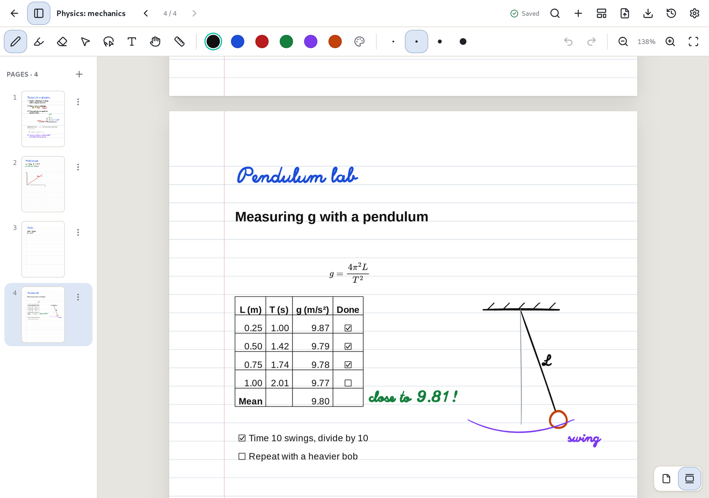
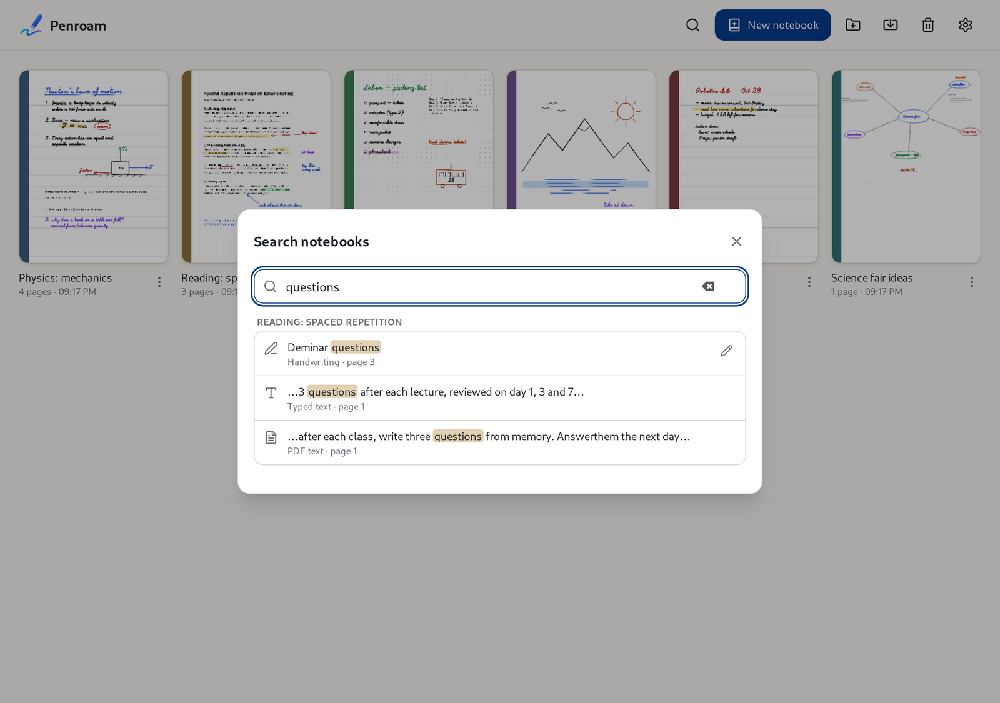
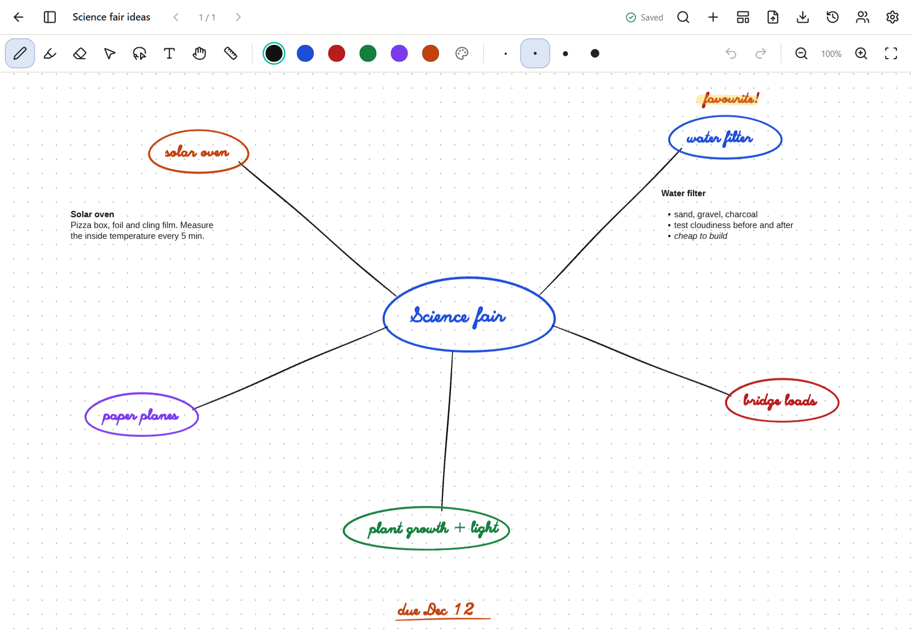
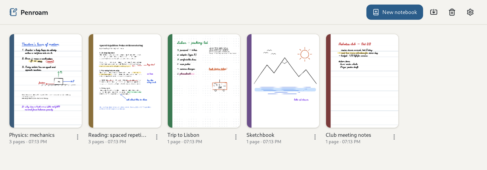

<h1> Penroam</h1>

**Your handwriting, everywhere you write.**

Penroam is a free, open-source notebook for people who think with a pen. Write by hand with a
stylus, mouse or finger, type and calculate next to your ink, mark up PDFs, and search everything
you wrote, handwriting included. It runs on desktops, tablets, phones and BOOX e-ink tablets.

It works fully offline and keeps your notes on your device in an open, documented format. You
don't need an account, a server or a subscription.

**[⬇ Download Penroam](https://github.com/nh-99/penroam/releases)** for Windows, macOS, Linux and
Android, or [join the iPhone and iPad beta](#install). Penroam is in **beta**: it works, with known gaps,
and not every platform has been tried on real hardware yet.

## Why Penroam

- **It feels like writing on paper.** Pressure-sensitive ink, a highlighter and an eraser, on
  ruled, grid, dotted or blank pages, or on a canvas with no edges.
- **It does what paper can't.** Typed notes, formulas and working spreadsheets sit on the same
  page as your handwriting, and search reads your handwriting.
- **Your notes stay yours.** No account, no ads, no analytics, no telemetry. Handwriting
  recognition runs on your device, and notes leave it only when you export, back up or sync them.
- **Your work is looked after.** Every stroke is saved as you write, pages keep their earlier
  versions, and your whole library backs up to a single file.

## Install

Download the file for your system from the **[releases page](https://github.com/nh-99/penroam/releases)**.
The macOS app is signed and notarized by Apple. The other packages aren't signed yet, so Windows may warn you the first time. The
[release matrix](docs/platforms/release-matrix.md) shows how far each platform has been tested.

| System | File | Notes |
|---|---|---|
| Windows (x86-64) | `…_x64-setup.exe` | The installer isn't signed yet, so Windows SmartScreen may stop it: choose **More info → Run anyway**. Not yet tried on real hardware. |
| macOS (Apple Silicon) | `….dmg` | Open it and drag Penroam to **Applications**. Not yet tried on real hardware. No Intel build. |
| Linux (x86-64) | `.AppImage` or `.deb` | `chmod +x Penroam*.AppImage` and run it, or `sudo apt install ./Penroam*.deb`. |
| Android and BOOX (arm64) | `…_android-arm64.apk` | Install the APK directly, or [open an issue](https://github.com/nh-99/penroam/issues/new/choose) to join the closed testing group on Google Play. |
| iPhone and iPad | TestFlight | Install [TestFlight](https://apps.apple.com/app/testflight/id899247664), then [open an issue](https://github.com/nh-99/penroam/issues/new/choose) to ask for an invitation. |

More about installing: the Linux AppImage, and building from source

**Linux AppImage.** When it starts, the AppImage adds Penroam to your app menu and keeps the
entry pointing at it if you move the file. To uninstall, choose **Remove from app menu** in
**Settings → Advanced**, then delete the AppImage.

**From source.** See the [developer README](docs/README.md) and
[docs/development.md](docs/development.md). A build you make yourself is listed as
**Penroam Developer**, so it doesn't replace a release you've also installed.

### Your first notebook

The first time you open Penroam, a short guided tour shows you around. You can take it again at any
time from **Settings → General**.

1. Click **New notebook**, give it a title and choose the paper.
2. Pick the pen (`P`) and write. The highlighter is `M`, the eraser `E` and the text tool `T`.
3. Add pages with **+**, and import a PDF with the button next to it.
4. Find anything with the magnifying glass (`Ctrl+K`, or `Cmd+K` on a Mac).

There is no save button: everything is saved as you write. The
[getting started](docs/manual/getting-started.md) chapter goes further.

## What you can do with it

### Write naturally

Ink responds to pressure, your stylus's eraser end and side button erase, and a ring shows where
a hovering pen will land. On a touchscreen you decide whether fingers draw or move the page. On
BOOX e-ink tablets, ink is drawn by the device's own low-latency pen layer.
[Writing and drawing →](docs/manual/writing.md)

### Type, format and calculate on the same page

Type anywhere on a page, in a handwritten or typeset font, with Markdown and LaTeX formulas that
look the same on screen, in PDFs and on paper. Every table is a small spreadsheet: formulas such
as `=SUM(B2:B5)`, checkboxes, money and percentage formats, sorting and filtering. Tables are saved
as plain Markdown, so they read well in any other app.
[Typing and formatting text →](docs/manual/text.md) · [Spreadsheets →](docs/manual/spreadsheets.md)

### Find anything, even handwriting

One search covers every notebook's titles, typed text, PDF text and handwriting. Recognition runs
on your device, never in the cloud, and if a word was read wrongly, correct it once and search
remembers. [Searching →](docs/manual/search.md)

### Mark up PDFs

Import a PDF, highlight and write in the margins, then export an annotated PDF in which your ink
stays sharp vector lines. The original PDF is never changed. [PDFs →](docs/manual/pdfs.md)

### Think without edges

Turn any notebook into an infinite canvas for mind maps, sketches and brainstorms that grows in
every direction as you write, and switch back to pages at any time.
[Pages and the infinite canvas →](docs/manual/pages-and-canvas.md)

### Keep your library in order

Give notebooks titles, cover colours, paper sizes and page styles, group them in folders, and
restore deleted ones from the trash. Bring notes in from Xournal++, Evernote, Joplin, Markdown,
text files and PDFs; Penroam tells you exactly what came across and what didn't.
[Your library →](docs/manual/library.md) · [Importing →](docs/manual/import-export.md#importing-from-other-apps)

### Saving, history and backups

Every change is written to disk as you make it, so after a crash your notebook reopens with what
you'd written. Version history lets you look back at any page and restore it, or a whole
notebook, without losing what you have now. Back up your library to a single file whenever you
like, or every day to a folder or a WebDAV server such as Nextcloud.
[Saving, backups and version history →](docs/manual/backups-and-history.md)

### Share between your devices

Notebooks are ordinary `.penroam` files you can copy anywhere. Optional sync through Penroam Cloud
keeps them up to date on all your devices. Synced notebooks are encrypted before upload, but
Penroam holds their key so that signing in is enough. For notes no one else should read, use a
vault, encrypted with a passphrase only you know.
[Sync and vaults →](docs/manual/sync-and-vaults.md)

### Print and export

Print a notebook or a few pages with ink as sharp as on screen, or export as `.penroam` files,
annotated PDFs, PNG or SVG images, Markdown or plain text.
[Importing, exporting and printing →](docs/manual/import-export.md)

### Make it yours

| Dark theme | ePaper theme |
|---|---|
|  |  |

Choose a light, dark or high-contrast ePaper theme (exports and printouts stay as you wrote them),
pick your own pen and highlighter colours, and use Penroam on a desktop, tablet or phone: the
layout adapts to each. [Settings →](docs/manual/settings.md)

## User manual

The **[user manual](docs/manual/README.md)** explains everything:

* [Getting started](docs/manual/getting-started.md)
* [Your library](docs/manual/library.md): notebooks, folders and the trash
* [Writing and drawing](docs/manual/writing.md): tools, colours, pens and touch
* [Typing and formatting text](docs/manual/text.md): Markdown, formulas and links
* [Spreadsheets](docs/manual/spreadsheets.md)
* [Pages and the infinite canvas](docs/manual/pages-and-canvas.md)
* [PDFs](docs/manual/pdfs.md)
* [Searching](docs/manual/search.md), including handwriting
* [Importing, exporting and printing](docs/manual/import-export.md)
* [Saving, backups and version history](docs/manual/backups-and-history.md)
* [Sync and vaults](docs/manual/sync-and-vaults.md)
* [Settings](docs/manual/settings.md)
* [Keyboard shortcuts](docs/manual/shortcuts.md)

## Where your notes live

Notebooks are stored in the app's private data folder on your device. They leave it only when
you export them, back them up, or turn on sync. You don't need an account, and Penroam has no
analytics or telemetry. Search works entirely on your device: the search index is kept in the
app's cache folder, and neither it nor anything you search for is uploaded or included in
exports. When you print, your device's print system receives a copy of what you print.

Backups and exports aren't encrypted, so keep them somewhere you trust. Sync and vault encryption
hasn't been independently reviewed yet; the [threat model](docs/security/threat-model.md) says
what the server can see. The `.penroam` format is documented in [docs/formats/](docs/formats/),
so your notes are never locked into this app.

## Contributing

Penroam is free software and maintained by one person, so help of every kind counts: bug
reports, test results from real devices (especially Windows, macOS, Samsung S Pen and iPad),
feedback on features, documentation fixes and code. Please open an issue before starting on
anything large.

* [CONTRIBUTING.md](CONTRIBUTING.md): how to contribute and what we look for
* [Developer README](docs/README.md): setting up, building, testing and how the code fits together
* [Issues](https://github.com/nh-99/penroam/issues): report a bug or suggest a feature

## License

Penroam is licensed under the [MPL-2.0](https://www.mozilla.org/MPL/2.0/).
The bundled Liberation Sans and Excalifont fonts are under the SIL Open Font License 1.1, and PDF.js is under
Apache-2.0. The Android build fetches the proprietary BOOX Onyx SDK from Onyx's official
repository to support BOOX pens.

## Help and privacy

**Problems.** See [getting help](docs/support.md) and [known issues](docs/known-issues.md). If
Penroam crashes it keeps a short report on your device, and nothing is sent anywhere; see
[Settings → About](docs/manual/settings.md#about) to share it in a bug report.

**Updates.** Builds that can update themselves check for new versions only if you turn that on in
**Settings → About**. See [Settings](docs/manual/settings.md#about).

**Privacy.** Penroam has no analytics or telemetry. [Privacy](docs/policies/privacy.md) lists every
case in which the app uses the network. See also [accessibility](docs/policies/accessibility.md).

**Security.** See [SECURITY.md](SECURITY.md).
