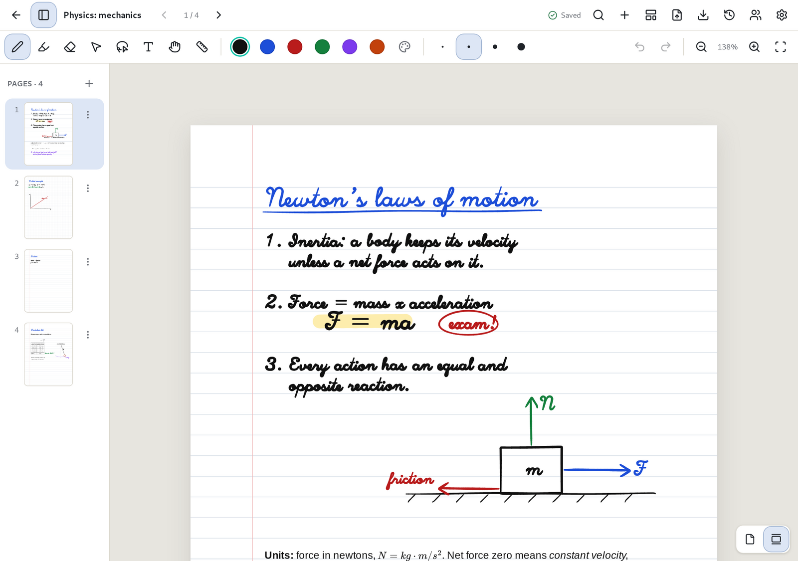

# Penroam user manual

This manual explains how to use Penroam, from your first notebook to backups and sync. If you're
new, start with [Getting started](getting-started.md). The other chapters can be read in any order.

## Chapters

1. [Getting started](getting-started.md): installing, the guided tour, your first notebook and
   finding your way around.
2. [Your library](library.md): notebooks, folders, covers and the trash.
3. [Writing and drawing](writing.md): the pen, highlighter, eraser and selection tools, colours,
   pens and touch, zoom and undo.
4. [Typing and formatting text](text.md): text boxes, fonts, rows, Markdown, formulas, links and
   task lists.
5. [Spreadsheets](spreadsheets.md): tables with formulas, checkboxes, sorting and filtering.
6. [Pages and the infinite canvas](pages-and-canvas.md): adding and arranging pages, paper
   styles, and notebooks with no edges.
7. [PDFs](pdfs.md): importing a PDF, writing on it and exporting it with your notes.
8. [Searching](search.md): finding typed text, PDF text and handwriting.
9. [Importing, exporting and printing](import-export.md): moving notebooks between devices,
   bringing notes from other apps, and getting them out again.
10. [Saving, backups and version history](backups-and-history.md): how your work is kept safe and
    how to go back to an earlier version.
11. [Sync and vaults](sync-and-vaults.md): keeping notebooks on several devices, and notes only
    you can read.
12. [Settings](settings.md): themes, tool colours, touch input, updates and diagnostics.
13. [Keyboard shortcuts](shortcuts.md): every shortcut in one place.

## More help

* [Getting help](../support.md): reporting a problem and answers to common questions.
* [Known issues](../known-issues.md): problems we know about, with workarounds.
* [Privacy](../policies/privacy.md): every case in which Penroam uses the network.
* [Deleting your account](../policies/delete-account.md): how to delete a Penroam Cloud account and
  what is kept.
* [Accessibility](../policies/accessibility.md): what works today and what doesn't yet.
* [Which devices Penroam runs on](../platforms/release-matrix.md).
