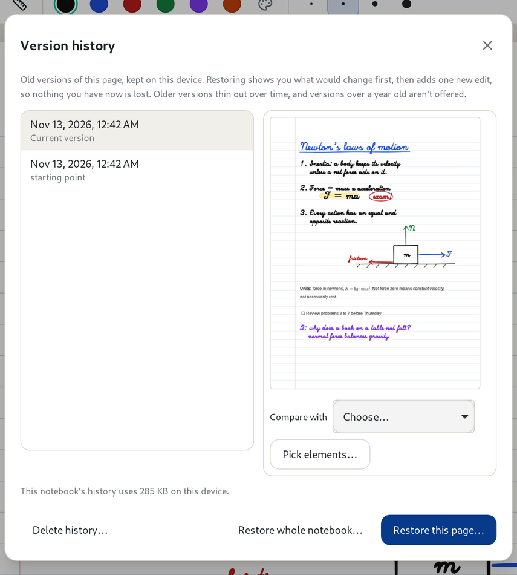

# Saving, backups and version history

[Manual](README.md) › Saving, backups and version history

## Saving

There is no save button to remember. Changes are written to disk as you make them, and the top bar
shows **Saved** once they are safe. `Ctrl+S` writes everything immediately if you want extra
reassurance.

If the app or computer crashes, reopen Penroam: your notebook comes back with everything you'd
written. **Settings → About** shows what start-up recovery did.

## Version history

Click the clock in a notebook's top bar to see this page's earlier versions, grouped by writing
session. Pick one to preview it, then compare it with another, restore the page, or restore the whole notebook
as it was at that time. Penroam first shows what the restore would change and lets you choose. In
your own notebook the restore returns it exactly to that version: things added since are removed
and pages made since move to the trash, unless you untick them. In a shared notebook, what others
added since stays. Restoring is a new edit, so the version you had stays in the list, the change
syncs like any other, and you can undo it by restoring again. See
[History and activity](history-and-activity.md#restoring).

Penroam keeps everything from the last week, then one version a day for a month, then one a week
for a year.

With sync on, history is part of your account, so a new device can reach versions made on devices
you no longer have. **Delete history…** removes a notebook's history from this device straight
away, and permanently deleting a notebook removes it too. Whatever has already synced stays in your
account, including things you've erased, until the account is deleted.

## Backing up everything

**Settings → Backup → Back up…** saves every notebook, including the trash, to one
`.penroam-backup` file, then reads it back to check it. It needs no account and no connection. The
file isn't encrypted, so keep it somewhere you trust. Version history and [vault](sync-and-vaults.md#vaults)
notebooks aren't in backups.

To restore, choose **Choose a backup…**. You'll see what's in the file before anything changes,
including any notebook that is damaged. Notebooks you already have are left alone unless you ask
for separate copies. Search rebuilds itself afterwards and keeps your corrections.

## Automatic backups

Under **Settings → Backup**, choose a folder or a WebDAV server such as Nextcloud. While Penroam is
open it saves a backup once a day and keeps the last seven.

* These are ordinary backup files: they aren't encrypted, and nothing syncs through them.
* A WebDAV address needs `https://`. Your password stays in your system's keychain.
* Backups on a WebDAV server are listed there, ready to restore.
* Folders aren't available on phones and tablets.

## Related

* [Known issues with backups](../known-issues.md#everywhere)
* [Exporting a single notebook](import-export.md)
