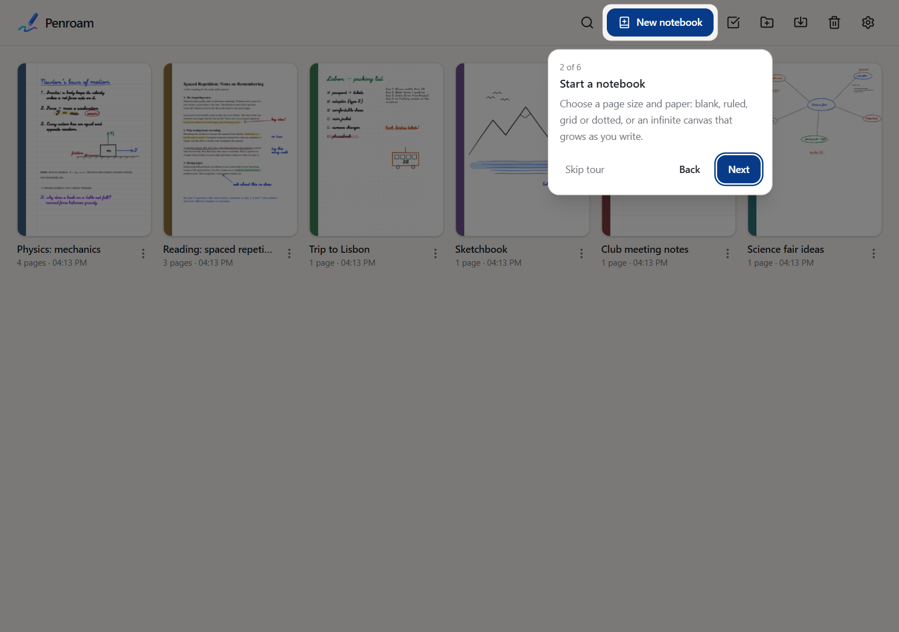
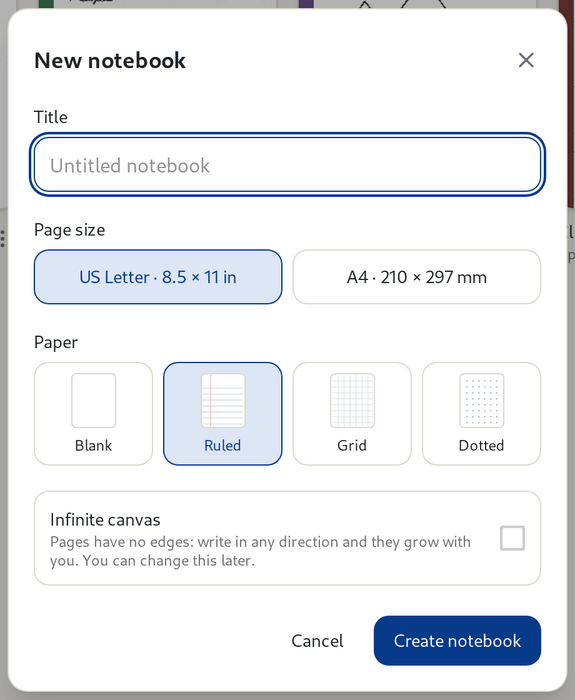
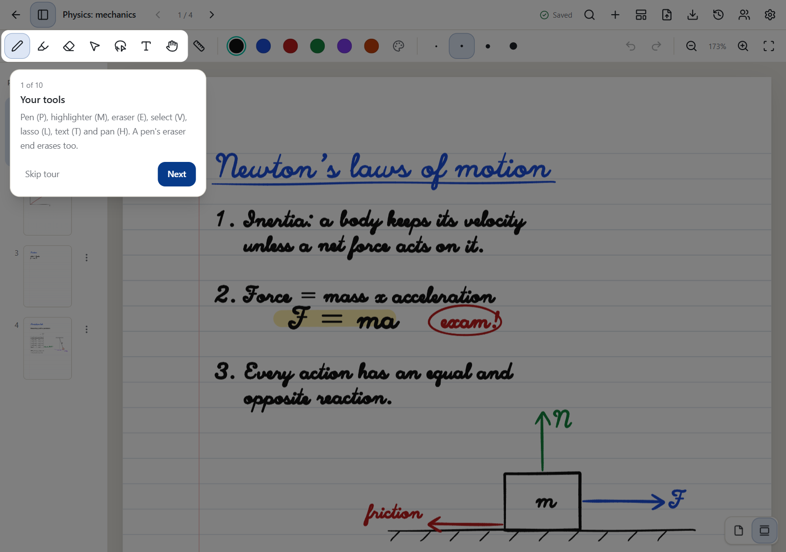

# Getting started

[Manual](README.md) › Getting started

## Installing Penroam

See [Install](../../README.md#install) in the README. Penroam runs on Windows, macOS, Linux,
iPhone and iPad, and Android, including BOOX e-ink tablets.

## The guided tour

The first time Penroam opens, it offers a short tour. Each step points at one part of the window
and says what it does. Use **Next** and **Back** (or the arrow keys) to move through it, and
**Skip tour** or `Esc` to close it. When you finish the library tour, a second one shows you around
the first notebook you open.

To see the tour again, open **Settings → General** and choose **Take the tour**. It shows you
around whichever view you're in: the library or a notebook.

## Your first notebook

Click **New notebook** at the top of the library. Give it a title, then choose:

* **Page size**: US Letter or A4.
* **Paper**: blank, ruled, grid or dotted.
* **Infinite canvas**: tick this for pages with no edges, which grow as you write. You can change
  it later.

Click **Create notebook**, and it opens, ready to write in.

## Finding your way around a notebook

* **The top bar** has the back arrow to the library, the page sidebar button, the notebook's
  title (click it to rename the notebook) and arrows to move between pages. On the right are the
  save indicator, search, add page, page template, PDF import, export and print, version history
  and settings.
* **The toolbar** below it holds the tools, colours and sizes, undo and redo, and zoom. See
  [Writing and drawing](writing.md).
* **The page sidebar** on the left shows every page. See
  [Pages and the infinite canvas](pages-and-canvas.md).

There is no save button. Everything is saved as you write, and the top bar shows **Saved** once
it's safe on disk. See [Saving, backups and version history](backups-and-history.md).

## Next steps

* [Write and draw](writing.md) with the pen, highlighter and eraser.
* [Type next to your ink](text.md), with formatting and formulas.
* [Import a PDF](pdfs.md) to mark it up.
* [Bring notes from another app](import-export.md#importing-from-other-apps).
