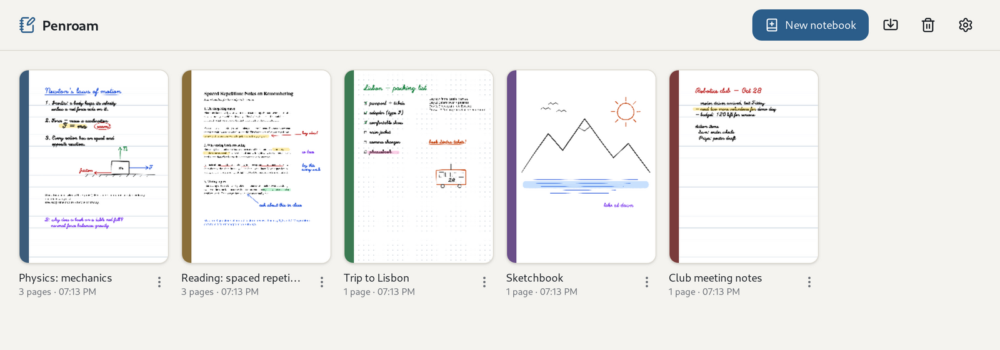

# Your library

[Manual](README.md) › Your library

The library is the first thing you see when Penroam opens. It shows every notebook as a card with
its cover colour and a preview of its first page, newest first.

## Notebooks

* **Create** a notebook with **New notebook**. See [Getting started](getting-started.md#your-first-notebook).
* **Open** a notebook by clicking its card.
* **Rename, duplicate, recolour, export, print or delete** a notebook from the **⋮** menu on its
  card: **Rename**, **Duplicate**, **Change cover colour**, **Export .penroam…**,
  **Export annotated PDF…**, **Print…** and **Move to trash**. You can also rename an open
  notebook by clicking its title in the top bar.
* **Duplicate** makes a copy called "*title* (copy)" in the same folder, or the same
  [vault](sync-and-vaults.md#vaults). It has every page and attachment, but not the original's
  trash or [version history](backups-and-history.md#version-history).

On a phone, the folder, import and trash buttons are in the **⋮** menu at the top of the library.

## Folders

Click the folder button at the top of the library to make a folder, then open a notebook's **⋮**
menu and choose **Move to folder…**. Folders can hold other folders, and a new notebook goes in the
folder you have open. Deleting a folder doesn't delete anything inside it: its notebooks and
folders move up one level. Notebooks in a [vault](sync-and-vaults.md#vaults) stay outside folders.

## The trash

Deleted notebooks go to the **Trash** (the bin button at the top of the library), where you can
restore them or delete them for good. Pages you delete from a notebook have a trash of their own;
see [Pages](pages-and-canvas.md#pages).

With sync on, deleting a notebook for good removes it from all your devices, but it stays in your
account: the Trash keeps it, and **Restore** brings it back everywhere. A notebook that's in your
account but not on this device shows on the shelf as a card with a cloud icon. Click it to download
the notebook.

## Related

* [Importing notebooks and documents](import-export.md#importing-from-other-apps)
* [Searching all your notebooks](search.md)
* [Backing up your library](backups-and-history.md#backing-up-everything)
