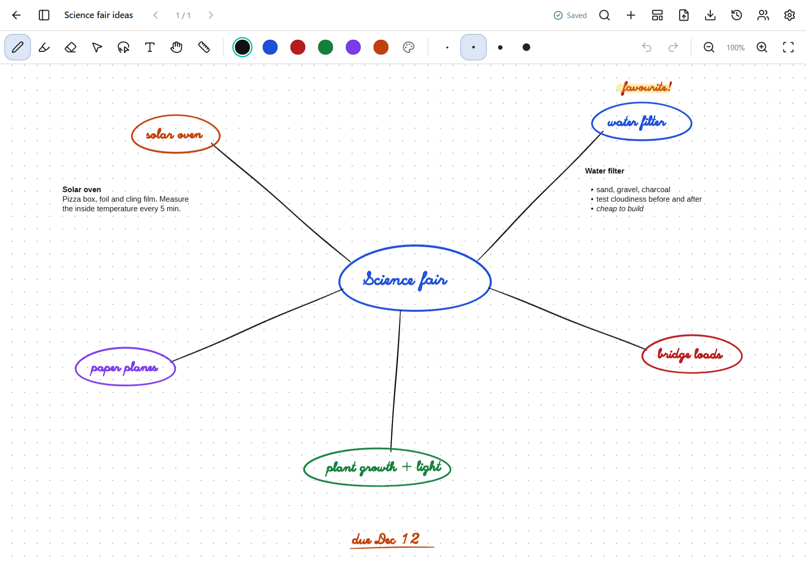

# Pages and the infinite canvas

[Manual](README.md) › Pages and the infinite canvas

## Pages

The sidebar on the left shows all of a notebook's pages; the sidebar button in the top bar shows
and hides it.

* **Add a page** with **+** in the sidebar or the top bar, or `Ctrl+Shift+N`.
* **Reorder pages** by dragging their thumbnails.
* **Insert, move or delete a page** from its **⋮** menu in the sidebar. Deleted pages can be
  restored from the sidebar.

All the pages of a notebook sit in one column: scroll down past the end of a page to reach the next
one. The page in the middle of the window is the one you're writing on. The sidebar, the arrows in
the top bar and `PgUp` / `PgDn` jump straight to a page. To see one page at a time instead, use the
page buttons at the bottom right of the canvas.

## Paper

Pages can be US Letter or A4, and blank, ruled, grid or dotted. You choose the size and paper when
you [create a notebook](getting-started.md#your-first-notebook). **Page template** in the top bar
changes the style of the page you're on.

## The infinite canvas

A canvas is a page with no edges: write, type and pan in any direction and it grows with you.

Tick **Infinite canvas** when you create a notebook, or choose **Page template → Infinite canvas**
in the top bar to switch a notebook either way. Blank, grid and dotted paper have no edges at all.
Ruled paper stays the page's width, with its header and margin line, and goes on downward for as
long as you write.

A canvas notebook can still have several pages, each a canvas of its own; the page sidebar starts
closed there, and the sidebar button opens it. When you turn the canvas on for a notebook with
several pages, Penroam asks whether to keep them or combine them onto one canvas, one below the
other. Combining moves the emptied pages to the notebook's trash, so you can restore them.

Turning the canvas off again shows the pages as sheets and changes nothing on them; anything beyond
a sheet's edge is still there when you turn it back on. **Fit** shows everything on the canvas, or
on ruled paper the page's width.

Annotated PDF export and printing lay a canvas out on pages of the notebook's paper size, breaking
between lines where they can; PNG and SVG export give one picture of the whole canvas. See
[known issues](../known-issues.md#infinite-canvas) for the limits.

## Related

* [PDFs on pages and canvases](pdfs.md)
* [Version history](backups-and-history.md#version-history), which keeps every page's earlier versions
