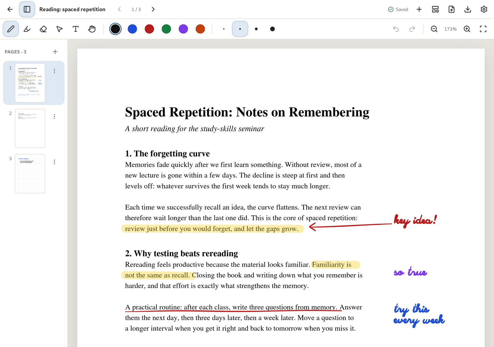

# PDFs

[Manual](README.md) › PDFs

## Importing a PDF

Open a notebook and click **Import PDF as pages** in the top bar to add every page of a PDF to the
notebook. Then write, highlight and type on it like any other page.

On an [infinite canvas](pages-and-canvas.md#the-infinite-canvas) the button is **Import PDF onto
this canvas**: the whole document goes onto the open canvas, below what's already there, and you
write on it the same way. Use **Undo** to take it off again.

To make a new notebook from a PDF instead, use **Import** in the library. See
[Importing from other apps](import-export.md#importing-from-other-apps).

The original PDF is kept inside the notebook unchanged, and search finds its text. See
[Searching](search.md).

## Getting the PDF back with your notes

Choose **Export and print → Annotated PDF…** in the top bar, or **Export annotated PDF…** from a
notebook's **⋮** menu in the library. Your ink stays sharp vector lines rather than a picture.

## Related

* [Printing](import-export.md#printing)
* [Other ways to export](import-export.md#other-ways-to-export)
