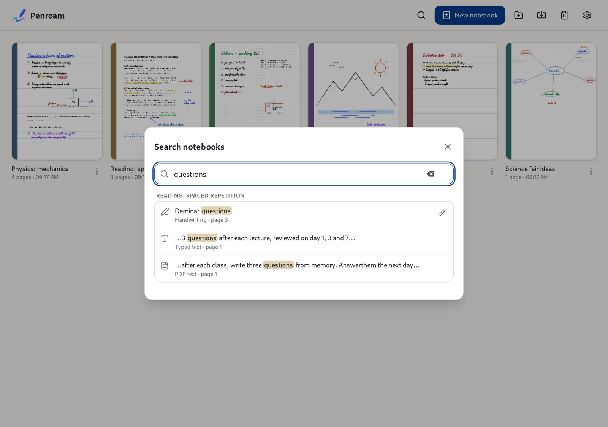

# Searching

[Manual](README.md) › Searching

Click the magnifying glass (`Ctrl+K` in the library, `Ctrl+F` in a notebook) and type. Penroam
searches every notebook's titles, typed text and the text of imported PDFs, and it reads your
handwriting too.

Choose a result to open its page with the matching words outlined. Each result says where the
match is: handwriting, typed text or PDF text.

* Quoted words (`"budget review"`) match as a phrase.
* Close misspellings still find handwriting that was read slightly wrong; such results are marked
  *similar spelling*.

## Handwriting

Penroam reads handwriting on your device, never in the cloud:

* **On Windows**, with the handwriting recognizer built into Windows.
* **On devices without one**, with a handwriting model that Penroam downloads once, shortly after
  you first open it. The download sends none of your notes. On Windows the model is optional, as a
  fallback; get it under **Settings → Advanced**.

Without a recognizer or an installed model, Penroam searches titles, typed text and PDF text, but
not handwriting.

**Correcting a reading.** If a handwritten line was read wrongly, click the pencil next to the
result and type what it says. Search uses your reading from then on, and your ink stays exactly as
you wrote it.

## Search settings

**Settings → Search** turns handwriting recognition on or off, pauses indexing, waits while the
device runs on battery, and rebuilds or deletes the search index.

**Settings → Advanced** chooses between your device's recognizer and the Penroam model where you
have both, and checks for model updates, installs a model from a file, or removes it. A model you
remove stays removed.

## Privacy

The search index is kept in the app's cache folder on your device. Neither it nor anything you
search for is uploaded or included in exports or backups; a restored backup rebuilds it and keeps
your corrections.

## Related

* [Exporting what search has read from your handwriting](import-export.md#other-ways-to-export)
