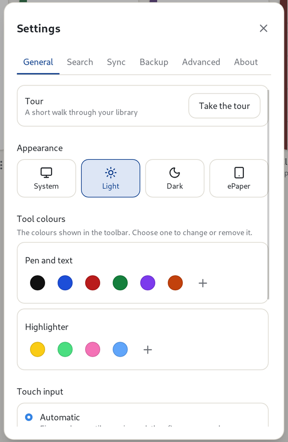
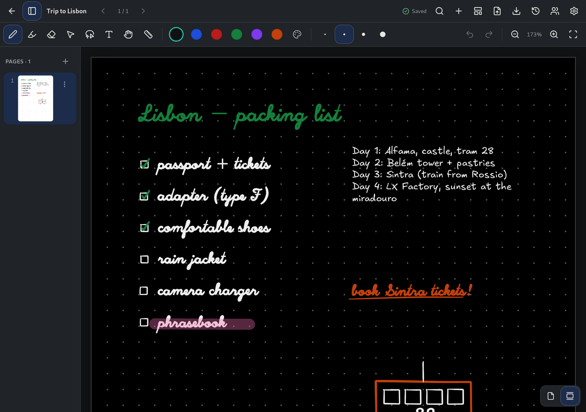
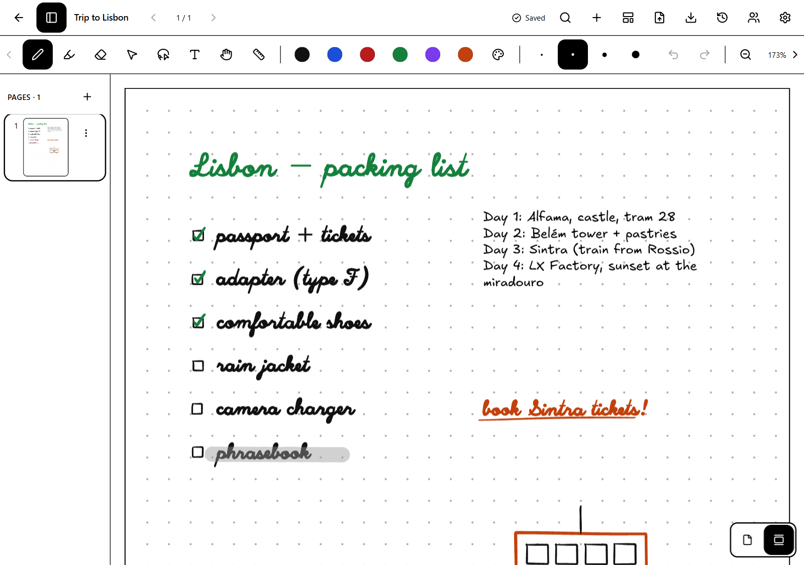

# Settings

[Manual](README.md) › Settings

Open **Settings** with the gear button at the top right of the library or of a notebook. Settings
belong to the device, not to your notebooks.

## General

* **Tour**: **Take the tour** walks you through the library or the notebook view, whichever is
  open. See [the guided tour](getting-started.md#the-guided-tour).
* **Appearance**: **System** (follows your device), **Light**, **Dark** or **ePaper**, a
  high-contrast theme for e-ink screens. The dark theme shows pages as black paper with black and
  white ink swapped; exports and printing stay as written. On BOOX tablets, Penroam picks ePaper
  the first time it starts.
* **Tool colours**: the colours the toolbar offers. Choose a colour to change or remove it, press
  **+** to add one, and **Reset** to go back to the original set. Pen and text share one set of
  colours, the highlighter has its own, and ink you've already drawn doesn't change.
* **Touch input**: what fingers do on a touchscreen. See
  [Fingers and touch](writing.md#fingers-and-touch).
* **Pressure-sensitive pen**: line width follows pen pressure when the device reports it.
* On BOOX and iPad, a switch for the device's **native pen layer**, which draws ink with less delay.
  Turn it off to use the ordinary canvas.

| Dark theme | ePaper theme |
|---|---|
|  |  |

## Search

Handwriting recognition, its language, pausing indexing, waiting while on battery, and rebuilding or
deleting the search index. See [Searching](search.md#search-settings).

## Sync

Signing in, your devices, vaults, and your Penroam Cloud plan and storage (**Compare plans** opens the
plan comparison). See [Sync and vaults](sync-and-vaults.md).

## Backup

Backing up and restoring the library, and automatic backups. See
[Backing up everything](backups-and-history.md#backing-up-everything).

## Advanced

* **Handwriting recognizer** and **Handwriting model**: which recognizer search uses, and checking
  for, installing or removing the handwriting model. See [Searching](search.md#handwriting).
* **Lock vaults when the app closes**. See [Vaults](sync-and-vaults.md#vaults).
* On Linux, the AppImage's **App menu** row removes Penroam from your app menu, or adds it back.

## About

* What Penroam does with your data, and what start-up recovery did after a crash.
* **Updates**: builds that can update themselves can check for a new version, choose the stable or
  beta channel, and turn on a check when Penroam starts. The check is off unless you turn it on.
  When it finds a new version, a notice with an **Update** button stays at the bottom of the window
  until you install or close it. Your notes are saved before an update installs, and they're stored
  apart from the app.
* **Problems**: if Penroam crashes it keeps a short report on your device. Nothing is sent
  anywhere. **Show diagnostic report** shows it so you can read it and copy it into a bug report.
  Reports hold no notes, file names or account details. See [Getting help](../support.md).
