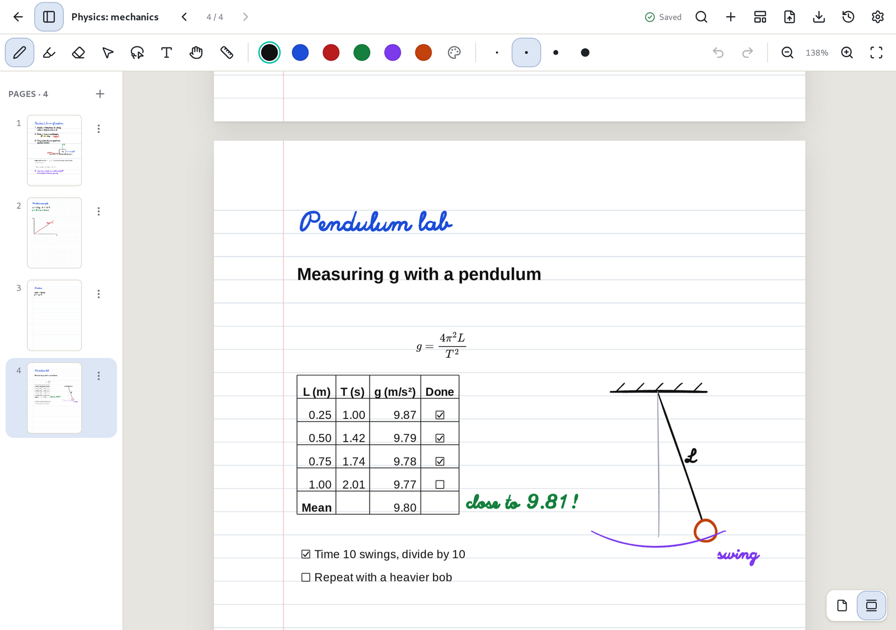

# Spreadsheets

[Manual](README.md) › Spreadsheets

Every table in a text box is a small spreadsheet. Use the table button in the formatting toolbar,
or type one in Markdown; once you click away from what you typed, it turns into a grid you can work
in like any spreadsheet. The cells are written in the box's font, so a table in a handwritten box
stays handwritten.

## Entering data

Click a cell (tap it with a pen or finger) and start typing to replace it, or press `Enter`, `F2`,
double-click or tap it again to change what's there. `Enter` and `Tab` move down and across, the
arrow keys move around, and `Tab` in the last cell adds a row. `Esc` cancels a change. `Delete`
clears the selected cells, `Shift` with the arrows or a drag selects several, and `Ctrl+D` fills
the top cell down. `Ctrl+C` and `Ctrl+V` copy and paste blocks of cells, to and from other
spreadsheet apps too. `Ctrl+Z` undoes.

## Kinds of value

Numbers can be written as `1,234.5`, `-3` or `12%`, and amounts of money as `$9.99`, `$ 9.99`,
`9.99 €` or `($9.99)` for a negative amount, with `$`, `€`, `£` or `¥`. Dates are `2026-11-10` or
`11/10/2026`. A cell holding just `[ ]` or `[x]` is a checkbox: click it or press `Space` to tick
it, and tap it on the finished page as well.

## Formatting

The bar above the grid shows the source of the cell you're on and formats the selected cells: bold,
italic and strikethrough; currency (pick the symbol), percentage, thousands separators and fewer or
more decimals, which turn `5` into `$5.00` or `0.12` into `12%`; and the column's alignment. The
bold, italic and strikethrough buttons in the main toolbar and `Ctrl+B` / `Ctrl+I` format the
selected cells too. A bold number is still a number, so it sorts and adds up as one. Number formats
change numbers only: a formula's result takes the format of the numbers it's made from.

## Formulas

Start a cell with `=`: `=B2*C2`, `=SUM(B2:B5)`, `=ROUND(AVERAGE(C2:C9), 2)`. Columns are lettered
from `A` and rows numbered from `1`, which is the header row, so the first row of data is row 2.
While you write a formula, click another cell to put in its reference.

You can use `+ - * / ^`, brackets and these functions:

| Function | Gives |
|---|---|
| `SUM` | The total |
| `AVERAGE` | The mean |
| `MIN`, `MAX` | The smallest or largest value |
| `COUNT` | How many numbers there are |
| `PRODUCT` | Everything multiplied together |
| `ROUND(x, n)` | `x` rounded to `n` decimals |
| `ABS` | The value without its sign |

Results take the style of what they add up, so a total of prices shows as money. The finished note
shows the results; the bar above the grid shows the formula of the cell you're on. A problem shows
as a code in the cell:

| Code | Meaning |
|---|---|
| `#ERROR!` | The formula can't be read |
| `#NAME?` | An unknown function |
| `#REF!` | A cell outside the table |
| `#VALUE!` | Text where a number is needed |
| `#DIV/0!` | Division by zero |
| `#NUM!` | A result too large |
| `#CYCLE!` | A formula that depends on itself |
| `#LIMIT!` | The table's ranges are too large in total |

## Sorting and filtering

Each column's header has a sort arrow: tap it to sort by that column, and again to sort the other
way. The arrow points the way the column is sorted. The arrows in the bar sort by the column you're
on. The menu button next to the arrow (or the column letter above the grid) also aligns, formats,
inserts and deletes columns, and a row number does the same for rows.

Sorting understands numbers, money, dates and checkboxes, leaves empty cells at the bottom and keeps
a totals row (a row whose formulas read other rows) where it is.

The filter button in the bar adds a row where you can type what to look for in each column: some
text, a comparison such as `>10`, `<=$5`, `>=2026-01-01` or `!=done`, or `yes`/`no` for
checkboxes. Filters only hide rows while you work in the grid; the note itself keeps every row.

## The Markdown stays

A table is saved as an ordinary Markdown table, so it reads well in any other app. The Markdown
button at the end of the bar shows the table's source to edit by hand. Tables inside lists and
quotations stay as source.

## Related

* [Typing and formatting text](text.md)
* [Exporting as Markdown](import-export.md#other-ways-to-export)
