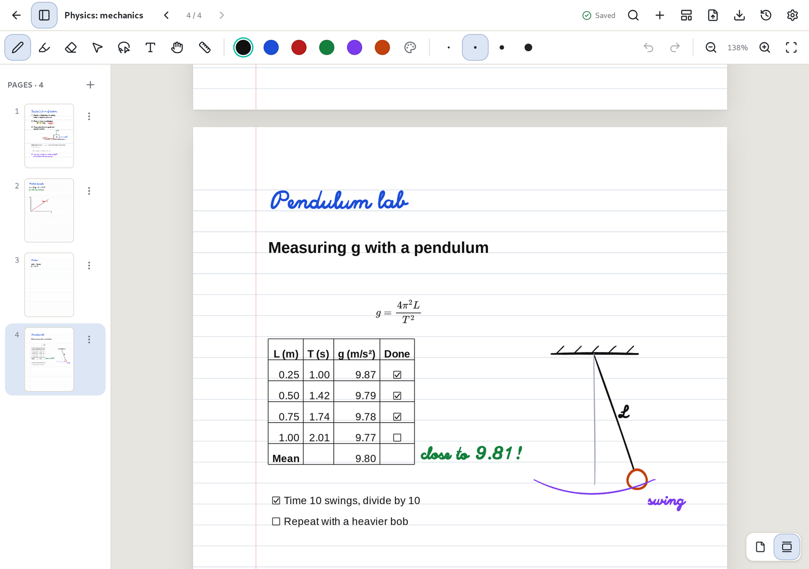

# Typing and formatting text

[Manual](README.md) › Typing and formatting text

Choose the Text tool (`T`), click where you want to type, and start typing. Click an existing text
box to edit it, or drag it to move it. `Esc` finishes the text box. With the select and lasso
tools, you can move, resize and recolour text boxes alongside your handwriting.



## Handwritten or formatted text

Text is handwritten by default, in the Excalifont typeface. With the Text tool, the two **Aa**
buttons in the toolbar choose the font for new text: **Handwritten**, or **Formatted** for a
cleaner, typeset look. With text boxes selected, the same buttons change their font. Lists,
checkboxes, links and the rest of the formatting work the same in both, code stays in a monospace
font, and PDF and SVG exports keep the font you chose. Text boxes from earlier versions of Penroam
stay formatted.

## Typing on rows

On ruled and dotted paper, text sits on the paper's rows: each line lands on a row, large text
takes more than one row, and dragging a text box moves it a row at a time. The rows button in the
toolbar turns this off, so new text can go anywhere on the page. With a text box selected, the
same button frees that box or puts it on the rows. Text boxes written freely, including those from
earlier versions of Penroam, stay where they are until you do. Blank paper, grid paper and PDF
pages have no rows, so text goes anywhere on them.

## Lining up text

When you drag a text box or click to start a new one close to another text box, it snaps into line
with it and a pink guide shows what it lined up with. Dragged boxes match left edges, centres and
right edges, and free text also matches tops and baselines. Hold `Alt` to place text without
snapping.

## Formatting

Write Markdown in a text box, or use the formatting buttons that replace the colour and size
controls in the toolbar while you edit: bold, italic, headings, lists, checkboxes, links, tables
and more. `Ctrl+B`, `Ctrl+I` and `Ctrl+K` (`Cmd` on macOS) do bold, italic and links. Formatting
appears as you type, and the Markdown symbols only show on the line you're on. Formulas stay as you
wrote them until you finish the box, and tables become [spreadsheets](spreadsheets.md). Press
`Enter` for a new line, which carries a list on, and leave a blank line for a gap. While you edit,
dragging inside the box selects text; drag the area just around it to move the box instead.

| Write | To get |
|---|---|
| `# Title` to `###### Title` | Headings |
| `**bold**`, `*italic*`, `~~struck~~`, `` `code` `` | Inline styles |
| `- item`, `1. item`, `- [ ] task`, `- [x] done` | Lists and task lists |
| `> quote` | A quotation |
| ` ``` ` on the lines above and below | A block of code |
| `\| a \| b \|`, then `\|---\|---\|`, then rows | A table, which works as a [spreadsheet](spreadsheets.md) |
| `---` | A horizontal line |
| `[text](https://example.com)`, `<https://example.com>` | A link |
| `$E = mc^2$` | An inline formula |
| `$$\sum_i x_i$$` | A formula on its own line |

## Formulas

Formulas use LaTeX with the AMS math environments. One Penroam can't draw, such as a typo in a
command, is shown as you wrote it. A dollar sign followed by a digit or a space stays a dollar
sign, and `\$` always does. Formulas look the same on screen, in exported PDFs and on paper.

Images in Markdown show their description, because Penroam doesn't fetch anything from the web for
a note.

## Links

Links are underlined. To open one in your browser or mail app, tap it with a finger (when the pen is
set to draw and fingers move the page) or with the hand tool, or `Ctrl`-click it (`Cmd`-click on
macOS) with any tool. Hovering over a link with the mouse shows its address. Only `http`, `https`
and `mailto` links open, and a web address written without `[...](...)` or `<...>` is plain text.

## Ticking tasks

Tap a checkbox in a task list to tick or untick it, with the pen, select or pan tool (a click works
too). With the pen, starting on a checkbox and drawing still draws; with the select tool, dragging
still moves the box. Undo brings the checkbox back.

## Related

* [Spreadsheets](spreadsheets.md)
* [Exporting text as Markdown](import-export.md#other-ways-to-export)
